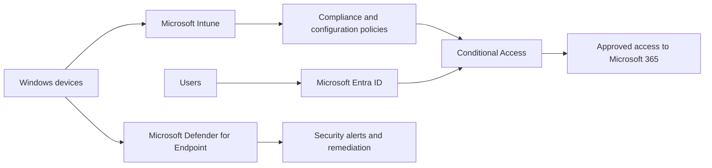

# Microsoft Cloud Administration & Endpoint Security Portfolio

A sanitised portfolio case study based on Microsoft cloud administration work for Falcon Projects, together with clearly labelled endpoint-security implementation examples.

> No names, email addresses, tenant identifiers, device serial numbers, credentials, screenshots, or production exports are included.

## Evidence status

### Current deployment follow-up

A controlled macOS pilot now has verified fresh Intune enrolment and check-in, compliant status in Company Portal, Defender activation, healthy/licensed status, service connectivity, and a successful EICAR antivirus quarantine test. See the [12 October 2026 pilot status](docs/macos-pilot-status.md) and [sanitised validation record](samples/DefenderMac.validation.json). Explicit pilot-policy results and Defender cloud alert visibility remain unverified. Security defaults are enabled; the [Conditional Access migration design](docs/conditional-access-migration.md) is prepared but not deployed. The September observations below are retained as a historical review.

| Status | Meaning |
| --- | --- |
| **Verified current state / pilot** | Observed during the dated September tenant review or October macOS pilot validation |
| **Completed — practitioner statement** | Work described by the practitioner but not attributable from the available portal history |
| **Demonstration** | Reusable design, checklist, or code example; not evidence that it ran in production |
| **Planned / unverified** | Requires tenant records, licensing, deployment reports, or test output before it can be presented as completed |

## September tenant review

The evidence review confirmed:

- A live Microsoft 365 tenant containing approximately **45 user identities**.
- Approximately **27 Microsoft 365 Business Basic assignments** visible in the tenant.
- A mixture of named, role-based, shared, external, licensed, and unlicensed identities.
- Administrative access to user, licence, product, and service-request views.
- A maintained cloud-hosted inventory linking organisational roles to company-device allocation and asset information.
- Individual Exchange Online and Planner/Project licensing in addition to the main Business Basic estate.

The public figures are deliberately rounded or aggregated. See the [sanitised evidence summary](docs/evidence-summary.md).

## Completed — practitioner statement

The following reflects hands-on responsibilities described by the practitioner. The live tenant confirms the environment exists, but the available views do not provide historical change attribution:

- Microsoft 365 user and licence administration.
- Creation and maintenance of role-based and shared organisational identities.
- Maintenance of an employee and company-device asset inventory.
- Day-to-day access and account support for the Falcon Projects environment.

## Demonstration material

These artefacts demonstrate implementation knowledge; they are not presented as production exports:

- A reference architecture connecting Entra ID, Intune, Defender for Endpoint, compliance, and Conditional Access.
- A phased endpoint-security implementation plan.
- A reusable deployment validation checklist.
- A read-only PowerShell endpoint-readiness script.
- A synthetic example showing the script's intended report structure.

## Evidence boundaries and remaining validation

The September review did not establish endpoint deployment. The October revision verifies one enrolled Mac and its local Defender protection. It still does **not** establish:

- Successful application of the named pilot compliance/configuration policies, or an estate-wide Intune rollout.
- Defender cloud device inventory, alert delivery, EDR detection, or incident remediation results.
- Conditional Access or MFA policy implementation results.
- Execution of the readiness script on a Windows endpoint.
- Level 3 support responsibility or advanced PowerShell expertise.

These remaining areas retain demonstration or planned status. The verified Mac results are recorded separately; the Windows readiness script remains a demonstration.

## Solution overview

The diagram above is a **demonstration architecture**, not an export of the Falcon Projects tenant.

## Repository contents

| Path | Status | Description |
| --- | --- | --- |
| [Evidence summary](docs/evidence-summary.md) | Verified current state | Sanitised scope, observations, and evidence boundaries |
| [macOS pilot status](docs/macos-pilot-status.md) | Verified pilot / pending checks | Fresh Intune enrolment, Defender validation and real enrolment recovery case |
| [macOS validation record](samples/DefenderMac.validation.json) | Verified pilot | Sanitised observed results; not synthetic data |
| [Conditional Access migration](docs/conditional-access-migration.md) | Planned | Current security defaults and a scoped replacement design |
| [Troubleshooting case study](docs/troubleshooting-case-study.md) | Verified portfolio audit | Real evidence mismatch, diagnosis, corrective action, and validation |
| [Architecture](docs/architecture.md) | Demonstration | Logical identity and endpoint-security architecture |
| [Implementation plan](docs/implementation-plan.md) | Demonstration | Phased deployment approach |
| [Validation checklist](docs/validation-checklist.md) | Demonstration | Acceptance template, not a completed test record |
| [Readiness script](scripts/Get-EndpointSecurityReadiness.ps1) | Demonstration | Read-only Windows endpoint readiness report |
| [Synthetic report](samples/EndpointSecurityReadiness.sample.json) | Demonstration | Example schema; not produced by a Windows execution |

## Skills represented

Microsoft 365 administration · Identity lifecycle support · Licence administration · Asset inventory · Microsoft Entra ID concepts · Microsoft Intune concepts · Microsoft Defender for Endpoint concepts · Conditional Access concepts · PowerShell · Technical documentation

## Evidence needed for the next revision

The next revision needs:

1. Named Intune policy results for the freshly enrolled Mac.
2. Defender cloud device/alert evidence and a separate EDR test result.
3. A licensed, approved Conditional Access migration and its validation results.
4. An active-device rollout inventory and verified enrolment results for each added device.
5. A real Windows script execution if the Windows demonstration is promoted to completed work.
