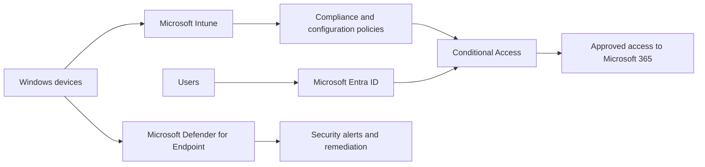

# Microsoft Cloud Security & Endpoint Deployment

A sanitized portfolio case study based on Microsoft cloud and endpoint work completed for Falcon Projects. It demonstrates a practical approach to deploying and managing:

- Microsoft Intune and Endpoint Manager
- Microsoft Defender for Endpoint
- Microsoft Entra ID
- Conditional Access and multifactor authentication
- Device compliance and security baselines

> This repository contains no customer data, credentials, tenant identifiers, production exports, or confidential configuration. The examples are reusable templates created for portfolio and demonstration purposes.

## Project objectives

The deployment was designed to improve device visibility, standardize endpoint configuration, strengthen identity controls, and provide a repeatable response process for endpoint threats.

## Solution overview

## Implementation areas

### Identity and access

- Organized users and security groups in Microsoft Entra ID.
- Applied multifactor authentication and Conditional Access principles.
- Used role-based access and least-privilege administration.
- Planned emergency-access and account-recovery procedures.

### Endpoint management

- Established Windows device enrolment and assignment groups.
- Defined configuration profiles and compliance requirements.
- Planned application deployment and update rings.
- Monitored non-compliant devices and remediation actions.

### Endpoint security

- Prepared devices for Microsoft Defender for Endpoint onboarding.
- Applied antivirus, firewall, attack-surface-reduction, and endpoint-detection controls.
- Documented alert triage, device isolation, investigation, and remediation steps.
- Verified device health and security reporting.

### Validation and handover

- Tested deployment with a pilot group before broader rollout.
- Recorded technical checks and acceptance criteria.
- Documented operational monitoring and support procedures.
- Produced a reusable readiness-reporting script.

## Repository contents

| Path | Description |
| --- | --- |
| [Architecture](docs/architecture.md) | Logical architecture and control flow |
| [Implementation plan](docs/implementation-plan.md) | Phased deployment approach |
| [Validation checklist](docs/validation-checklist.md) | Technical validation and handover checklist |
| [Readiness script](scripts/Get-EndpointSecurityReadiness.ps1) | Read-only Windows endpoint readiness report |

## Skills demonstrated

Microsoft Intune · Microsoft Defender for Endpoint · Microsoft Entra ID · Conditional Access · Microsoft 365 · Endpoint security · Device compliance · PowerShell · Technical documentation

## Important note

This is a sanitized technical portfolio project. Exact customer architecture, policy values, device counts, security findings, and tenant-specific information are intentionally excluded.
