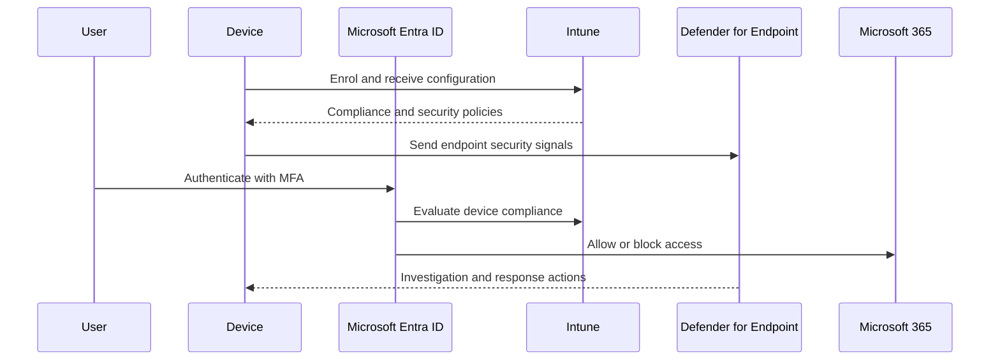

# Solution architecture

## Control model

The solution connects identity, device management, endpoint protection, and access enforcement:

1. **Microsoft Entra ID** provides identities, security groups, authentication, and administrative roles.
2. **Microsoft Intune** manages device enrolment, configuration profiles, applications, updates, and compliance.
3. **Microsoft Defender for Endpoint** provides endpoint visibility, threat detection, investigation, and response.
4. **Conditional Access** evaluates identity and device signals before access is granted to protected resources.

## Logical flow

## Security design principles

- Start with a controlled pilot group.
- Apply least privilege to administrative roles.
- Require strong authentication for administrators and users.
- Use device compliance as an access signal.
- Roll out restrictive controls in report-only or test mode first.
- Maintain documented recovery and emergency-access procedures.
- Never store secrets, exported tokens, or tenant-specific data in source control.
